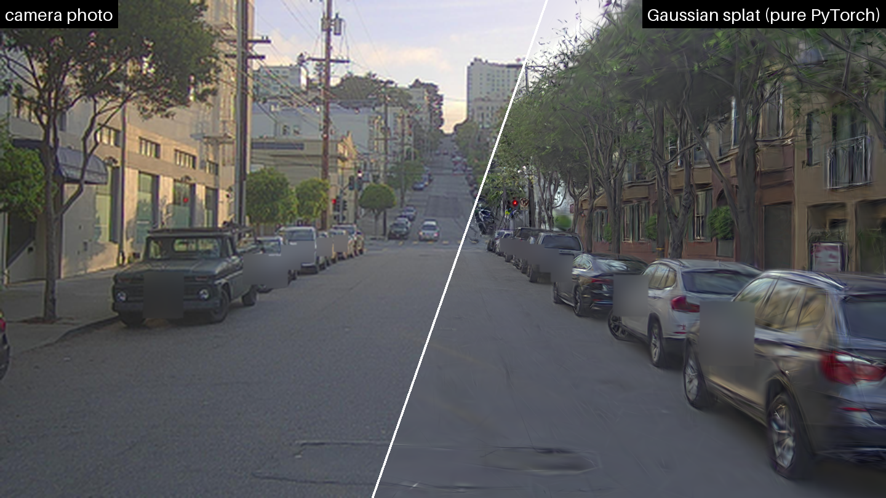
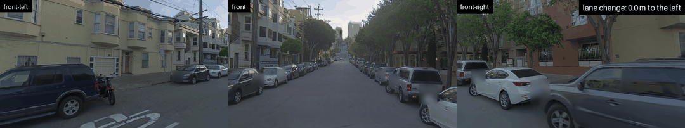

# Gaussian Splatting for Self-Driving Simulation, Built in Plain PyTorch

[3D Gaussian Splatting](https://arxiv.org/abs/2308.04079) for driving scenes, implemented entirely in PyTorch with no custom CUDA kernels. It reconstructs a PandaSet drive from camera and LiDAR data and renders it from the recorded path or from a different lane.

The training environment has no [gsplat](https://arxiv.org/abs/2409.06765), no compiled extensions and no CUDA toolkit.



*Left: a held-out camera photo. Right: the reconstruction rendered from the same position. License plates blurred. (Image produced by 06_figures.py; Data: PandaSet by Hesai and Scale AI, CC BY 4.0)*

## Features

- Rendering and training written in plain PyTorch (`splat/render.py`)
- Tested on an NVIDIA RTX A1000 - 4GB
- PandaSet loading: cameras, LiDAR and 3D boxes; moving objects and people masked out of training
- Lane-change rendering for the whole camera rig, with a realism score off the recorded path
- Optional comparison against gsplat's CUDA rasterizer

## PandaSet

[PandaSet](https://arxiv.org/abs/2112.12610), from Hesai and Scale AI, is a public self-driving dataset of more than 100 sequences, each 8 seconds long (80 frames at 10 Hz). Each sequence has:

- **Cameras:** six cameras (front, front-left, front-right, left, right, back) at 1920×1080, covering all around the car.
- **LiDAR:** two LiDARs, a 360° spinning LiDAR (Pandar64) and a forward-facing long-range LiDAR (PandarGT).
- **Poses and calibration:** the position and orientation of every camera and LiDAR in every frame.
- **Annotations:** 3D boxes for vehicles, people and other objects, and, for some sequences, a semantic label for every LiDAR point.

The distance covered in a sequence depends on the car's speed; sequence 028, used here, is an 84 m drive.

## Main model

The results below are for the main model:

- **Scene:** PandaSet sequence 028, an 84 m drive up a residential street (80 frames, 8 seconds).
- **Camera data:** the three forward cameras only (front, front-left, front-right), downscaled to 480×270. Every 8th frame is held out for testing: 210 training images, 30 test images.
- **LiDAR data:** both LiDARs (the 360° spinning LiDAR and the forward-facing long-range LiDAR), used for the Gaussians' starting points and to check rendered depth during training.
- **Training:** 30,000 steps, starting from 400,000 Gaussians and capped at one million.

The other three cameras (left, right, back) are used only in the [camera and configuration variants](#camera-and-configuration-variants-under-lane-shifts).

## Results

Main model.

| | Value |
|---|---|
| Held-out PSNR / SSIM / LPIPS | 28.19 dB / 0.836 / 0.146 |
| Gaussians | 999,486 |
| Training time (30,000 steps) | 119 min |
| Peak training memory | 1.92 GB |
| Rendering speed | 9.6 FPS at 480×270 |

PSNR: peak signal-to-noise ratio (higher is better). SSIM: structural similarity index (higher is better). LPIPS: learned perceptual image patch similarity (lower is better). All three compare the renders with the 30 held-out photos.

Compared with gsplat (same data and settings, only the rasterizer swapped):

| Rasterizer | Training time | PSNR | SSIM | LPIPS |
|---|---|---|---|---|
| Pure PyTorch (this repository) | 119 min | 28.19 dB | 0.836 | 0.146 |
| gsplat 1.5.3 (CUDA) | 23 min | 28.18 dB | 0.836 | 0.146 |

The pure-PyTorch rasterizer gives the same image quality as gsplat on all three metrics.

Lane changes: Fréchet distance to the real photos (lower is better), with the camera rig on the recorded path or shifted to the left:

| | Recorded path | 2 m left | 3 m left |
|---|---|---|---|
| Fréchet distance | 179 | 403 | 579 |

The Fréchet distance measures how different the renders are from the real photos as a whole set: both sets of images are passed through DINOv2, and the distance between their feature distributions is computed. It does not need a photo taken from the same position, so it can score views from another lane, where no photos exist.



*The drive replayed with a lane change (frames rendered by the model from viewpoints not in the training data): the three front cameras move together 3 m to the left into the oncoming lane and back. Animation created by `scripts/05_novel_views.py`.*


## Installation

```bash
git clone <repository-url>
cd <repository-folder>
conda env create -f env/environment.yml
conda activate pandaset-splat
```

or, with pip:

```bash
pip install -r env/requirements.txt
```

`env/pip_freeze_pandaset-splat.txt` lists the exact versions used. LPIPS and DINOv2 weights are downloaded on first use. LPIPS is an image-quality metric that compares a render with the real photo using features of a pretrained AlexNet network; it is reported alongside PSNR and SSIM. DINOv2 is a pretrained image model from Meta whose features are used for the lane-change realism score (Fréchet distance, `08_eval_offpath.py`).

gsplat is optional and only needed for the comparison scripts. The comparison with gsplat needs gsplat installed separately, preferably in its own environment (tested with gsplat 1.5.3).

## Data

Download [PandaSet](https://arxiv.org/abs/2112.12610) and place the sequences under `pandaset_archive/`, one folder per sequence, as distributed.


Another location can be passed with `--pandaset-dir`. The dataset is not included in this repository.

## Usage


```bash
python scripts/01_prepare_scene.py --seq 028   # prepare images, masks and LiDAR data
python scripts/02_check_scene.py               # calibration check and top-view map
python scripts/03_train.py                     # train the model 
python scripts/04_replay.py                    # held-out metrics and the replay video
python scripts/05_novel_views.py               # lane-change figures and animation
python scripts/06_figures.py                   # training progress and header figures
```

`run_all.sh` runs the six steps above in order.

| Script | Purpose | Output |
|---|---|---|
| `01_prepare_scene.py` | Prepare a PandaSet sequence for training | `data/pandaset_<seq>/` |
| `02_check_scene.py` | Calibration check and top-view map | `figures/` |
| `03_train.py` | Train the model | `outputs/train/` |
| `04_replay.py` | Held-out metrics, replay video, render speed | `outputs/replay/`, `figures/` |
| `05_novel_views.py` | Lane-change figures and animation | `outputs/novel/`, `figures/` |
| `06_figures.py` | Training progress, curves and header figures | `figures/` |
| `07_compare_backends.py` | Training time vs quality, PyTorch vs gsplat | `figures/` |
| `08_eval_offpath.py` | Score how realistic a model looks with the cameras on the recorded path and moved 2 m and 3 m into the left lane. Run once on the main model; the variant scripts run it automatically. | `outputs/study/` |
| `bench_renderer.py` | Measure how fast the pure-PyTorch renderer is on the trained model (render plus gradient), comparing the hand-written gradient with PyTorch autograd and 8×8 with 16×16 pixel tiles. | `outputs/bench/` |
| `bench_vs_gsplat.py` | Render the trained model with both this renderer and gsplat, and compare their speed and how closely their images match. Needs gsplat. | `outputs/bench/`, `figures/` |
| `diagram_compositing.py` | Draw the diagram of how the renderer builds an image tile by tile (`fig_compositing_diagram.png`). Not needed to run the pipeline. | `figures/` |
| `run_offpath_study*.sh` | Camera and configuration variants under lane shifts - see [Camera and configuration variants under lane shifts](#camera-and-configuration-variants-under-lane-shifts) section below | `outputs/study/` |
| `09_offpath_figures.py` | Charts for the camera and configuration variants | `figures/` |

Common options of `03_train.py`: `--steps`, `--max-gaussians`, `--init-points`, `--sh-degree`, `--depth-lambda`, `--needle-reg`, `--save-at`, `--backend {torch,gsplat}`. Common options of `01_prepare_scene.py`: `--seq`, `--cameras`, `--downscale`, `--pandaset-dir`.

### Camera and configuration variants under lane shifts

This is a separate set of experiments. Models of the same street scene are trained  with more cameras or different training settings, and then tested with the cameras shifted into the left lane, to see which model variant looks most realistic in a different lane.

It trains five more models from scratch, each with one change from the main model:

| Script | Model | Training steps |
|---|---|---|
| `run_offpath_study.sh` | Six cameras instead of three | 30,000 |
| | Six cameras, with an anti-needle loss and an opacity penalty | 30,000 |
| `run_offpath_study2.sh` | Three cameras, less view-dependent color (SH degree 1) | 30,000 |
| | Three cameras, with an anti-needle loss | 30,000 |
| `run_offpath_study3.sh` | Six cameras, 1.2M Gaussians, with an anti-needle loss | 60,000 |

Each run saves checkpoints during training, and every checkpoint is scored on the recorded path and with the cameras moved 2 m and 3 m into the left lane. Together, the runs show whether longer training helps in another lane and whether these changes help.

The six-camera runs need a six-camera version of the scene, prepared first:

```bash
python scripts/01_prepare_scene.py --seq 028 --out-dir data/pandaset_028_6cam --cameras \
    front_camera front_left_camera front_right_camera left_camera right_camera back_camera
bash scripts/run_offpath_study.sh
bash scripts/run_offpath_study2.sh
bash scripts/run_offpath_study3.sh
python scripts/08_eval_offpath.py --ckpts outputs/train/ckpt.pt --labels 3cam@30k \
    --out outputs/study/eval_baseline_front3.json
python scripts/09_offpath_figures.py \
  --model "3 cameras (main model)" outputs/study/eval_baseline_front3.json "3cam@30k" \
  --model "3 cameras + anti-needle loss" outputs/study/eval_needle_front3.json "needle@30k" \
  --model "3 cameras, SH degree 1" outputs/study/eval_sh1_front3.json "sh1@30k" \
  --model "6 cameras, 60k steps" outputs/study/eval_6cam_60k_front3.json "6cam_60k@60k" \
  --steps "3 cameras, 30k-step schedule" outputs/study/eval_needle_front3.json \
  --steps "6 cameras, 60k-step schedule" outputs/study/eval_6cam_60k_front3.json \
  --exclude "6cam_60k@15k"
```

### Tests and benchmarks

```bash
python tests/test_backward.py          # renderer gradients vs PyTorch autograd
python tests/test_vs_gsplat.py         # renderer vs gsplat (needs gsplat)
python scripts/bench_renderer.py --ckpt outputs/train/ckpt.pt --backwards manual autograd --tiles 8 16 \
    --out outputs/bench/renderer_ablation.json
python scripts/bench_vs_gsplat.py      # needs gsplat
python scripts/03_train.py --backend gsplat --out-dir outputs/train_gsplat   # needs gsplat
python scripts/07_compare_backends.py
```


## Repository structure

```text
.
├── splat/          # library: renderer, model, PandaSet loading, metrics, privacy blurring
├── scripts/        # pipeline steps, benchmarks and study runs
├── tests/          # renderer tests
├── env/            # environment.yml, requirements.txt, pip freeze
├── figures/        # figures (privacy-blurred)
└── run_all.sh      # main pipeline in order
```

## Privacy

Every photo and render in `figures/` has license plates and people blurred (`splat/privacy.py`).


## Acknowledgements

- [3D Gaussian Splatting](https://repo-sam.inria.fr/fungraph/3d-gaussian-splatting/) (Kerbl et al., SIGGRAPH 2023)
- [PandaSet](https://arxiv.org/abs/2112.12610) (Hesai and Scale AI)
- [gsplat](https://github.com/nerfstudio-project/gsplat), used as the reference implementation
- [SplatAD](https://arxiv.org/abs/2411.16816), whose lane-shift evaluation protocol is followed
- [TC-GS](https://arxiv.org/abs/2505.24796), whose matrix-multiply formulation of alpha is used in the renderer
- [DINOv2](https://github.com/facebookresearch/dinov2), used for the realism score
